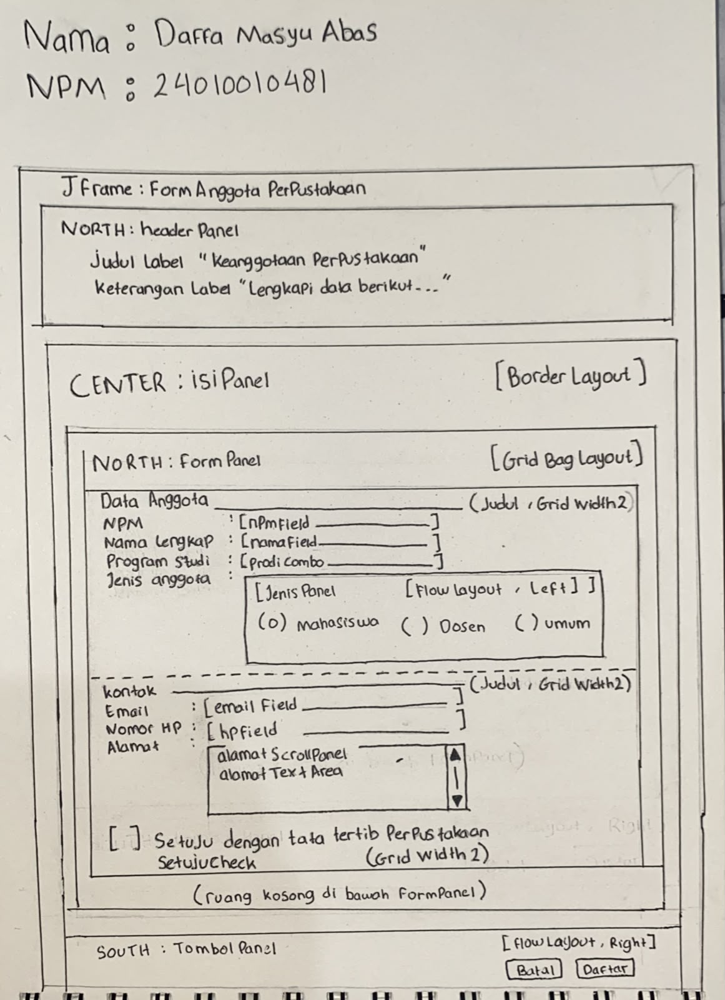
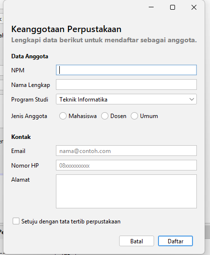
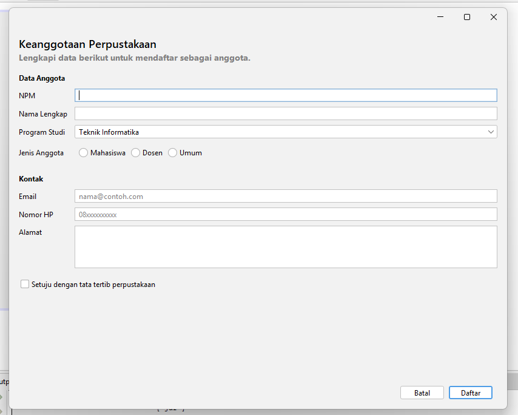
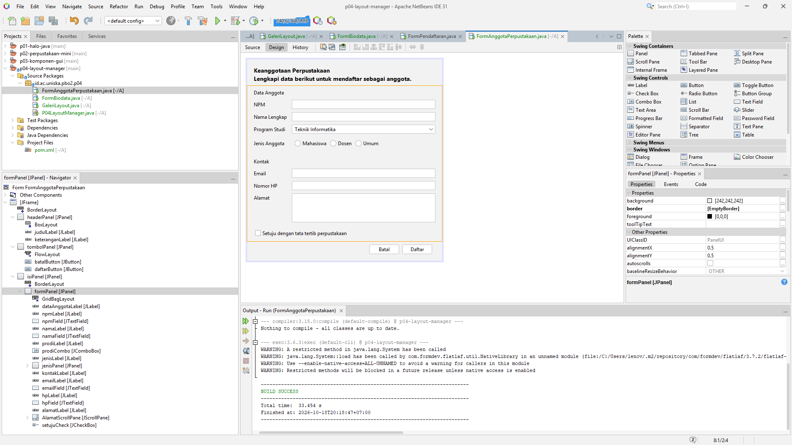

# P04: Layout Manager dan Desain Form

Nama: Daffa Masyu Abas
NPM: 2410010481
Mata Kuliah: Pemrograman Berbasis Objek 2 (TIF1508)
Proyek: p04-layout-manager

Isi proyek:

- `GaleriLayout` (galeri BorderLayout, FlowLayout, GridLayout, BoxLayout, dan layout bersarang)
- `FormBiodata` (latihan GridBagLayout)
- `FormAnggotaPerpustakaan` (studio desain)

Semua form dibuat dengan JFrame Form dan layout manager lewat menu Set Layout, tanpa Null Layout maupun Absolute Layout.

---

## 1. Sketsa dan Tabel Rancangan

### Foto sketsa

### Tabel rancangan

| Bagian | Panel | Layout |
|---|---|---|
| Jendela | JFrame | BorderLayout |
| Header (North) | headerPanel | BoxLayout (Y Axis) |
| Isi form (Center) | isiPanel (pembungkus) | BorderLayout |
| Baris-baris form (North di isiPanel) | formPanel | GridBagLayout |
| Jenis anggota | jenisPanel | FlowLayout (Left) |
| Tombol (South) | tombolPanel | FlowLayout (Right) |

---

## 2. Tangkapan Layar

### Ukuran awal

### Saat dilebarkan

### Tab Design dan jendela Navigator

---

## 3. Jawaban Eksperimen

### Praktikum 2: Galeri Layout Manager

Eksperimen 1: Alignment flowPanel diubah ke Center

Setelah Alignment saya ganti dari Left ke Center, tombol-tombolnya yang tadinya rata kiri jadi berkumpul di tengah. Waktu jendela saya kecilkan, tombol yang sudah tidak muat pindah ke baris bawah, dan tiap barisnya tetap rata tengah. Baris di `initComponents()` yang ikut berubah adalah `flowPanel.setLayout(new java.awt.FlowLayout(java.awt.FlowLayout.CENTER, 8, 8));`, sebelumnya `FlowLayout.LEFT`.

Eksperimen 2: gridPanel dengan Rows 0 dan Columns 2

Baris yang terbentuk ada 5. Kalau Rows diisi 0, jumlah baris dihitung sendiri dari jumlah komponen dan jumlah kolom. Ada 9 tombol dan 2 kolom, jadi 9 dibagi 2 dibulatkan ke atas menjadi 5 baris. Baris terakhir cuma berisi satu tombol, yaitu tombol 9.

Eksperimen 3: maximumSize boxPanel 32767 dan Vertical Strut

Sebelum diubah, lebar tombol di boxPanel beda-beda, mengikuti panjang teksnya. Setelah maximumSize lebarnya saya isi 32767, semua tombol melebar memenuhi lebar panel dan ukurannya jadi seragam. Vertical Strut yang saya taruh di antara tombol menambah jarak tetap antartombol, jadi susunannya tidak menempel lagi.

### Praktikum 4: Form Biodata

Eksperimen 1: Weight X namaField diubah ke 0.0

Waktu jendela saya lebarkan, isian Nama lengkap ternyata tetap ikut melebar. Penyebabnya, lebar kolom dibagi berdasarkan Weight X terbesar di kolom itu, dan isian lain (NPM, Email, dan seterusnya) masih memakai 1.0. Fill Horizontal pada namaField juga membuatnya memenuhi sel. Jadi satu isian yang diubah tidak cukup untuk menghentikan pelebaran.

Eksperimen 2: Direction formPanel di isiPanel diubah dari North ke Center

Saat jendela saya tinggikan, formPanel ikut ditarik memenuhi tinggi isiPanel, sehingga baris-barisnya jadi renggang dan bergeser dari atas. Kalau di North, baris form tetap menempel di atas dan ruang kosongnya ada di bawah. Dari situ saya paham kenapa formPanel dibungkus isiPanel dan diletakkan di North.

Eksperimen 3: Baris `setMinimumSize(getSize())` dihapus

Saat jendela saya kecilkan sekecil mungkin, isian dan label yang kena duluan: teks label terpotong dan isian menyempit, lalu tombol Batal dan Simpan di bawah ikut terpotong. Tanpa ukuran minimum, jendela bisa dikecilkan sampai isinya berantakan.

---

## 4. Saling Menilai (Tahap 4)

| Keterangan | Isi |
|---|---|
| Teman yang menilai | M. Ridho Fadillah (2410010166) |
| Hasil daftar periksa | 8 |

### Daftar periksa

| No | Pemeriksaan | Ya atau Belum |
|---|---|---|
| 1 | Label singkat, jelas, dan sejajar | YA |
| 2 | Isian dikelompokkan dengan judul bagian | YA |
| 3 | Placeholder dipakai untuk isian yang punya format | YA |
| 4 | Komponen sesuai jenis data | YA |
| 5 | Tombol utama menonjol dan berada di kanan bawah | YA |
| 6 | Jarak antar komponen konsisten | YA |
| 7 | Form tetap rapi saat jendela dilebarkan dan ditinggikan | YA |
| 8 | Dibuat dengan JFrame Form dan layout manager, bukan Null Layout atau Absolute Layout | YA |

### Saran dari teman

Isikan placeholder pada field NPM

### Tindak lanjut

Sudah diterapkan (foto tsb ketika belum diterapkan)

---

## 5. Jawaban Pertanyaan Refleksi

1. Mengapa Null Layout dan Absolute Layout sebaiknya dihindari?

Keduanya memakai posisi dan ukuran piksel yang tetap. Akibatnya tampilan tidak menyesuaikan saat jendela diubah ukurannya, dan teks bisa terpotong di layar dengan skala berbeda. Absolute Layout juga butuh library tambahan dari NetBeans, jadi aplikasinya susah dijalankan di komputer lain.

2. Jelaskan perbedaan perilaku FlowLayout dan GridLayout saat jendela dilebarkan.

FlowLayout memakai ukuran asli komponen. Saat jendela dilebarkan, komponen tetap berukuran sama dan hanya berderet atau pindah baris sesuai ruang yang ada. GridLayout membagi panel menjadi sel yang sama besar, jadi saat jendela dilebarkan semua sel dan komponennya ikut melebar secara merata.

3. Apa fungsi Weight X dan Fill pada constraint GridBagLayout?

Weight X menentukan pembagian sisa lebar antarkolom. Kolom dengan Weight X 1.0 mendapat sisa lebar, sedangkan 0.0 tetap pada lebar aslinya. Fill menentukan apakah komponen memenuhi selnya. Dengan Fill Horizontal, isian ikut melebar mengikuti kolomnya. Keduanya dipakai bersama pada kolom isian supaya label tetap dan isian yang melebar.

4. Mengapa formPanel dibungkus isiPanel dan diletakkan di North?

Kalau formPanel langsung di Center, ia akan ditarik memenuhi seluruh tinggi jendela dan baris-barisnya jadi renggang saat jendela ditinggikan. Dengan dibungkus isiPanel (BorderLayout) dan ditaruh di North, tinggi formPanel mengikuti isinya, jadi baris form tetap rapat di atas dan sisa ruang kosong ada di bawah.

5. Sebutkan dua prinsip desain yang Anda terapkan pada Form Anggota Perpustakaan dan tunjukkan buktinya.

- Keselarasan: semua label ada di kolom 0 dengan Anchor West, dan semua isian ada di kolom 1, sehingga membentuk garis lurus dari atas ke bawah. Buktinya terlihat di screenshot ukuran awal dan saat dilebarkan.
- Kedekatan: isian yang berkaitan dikelompokkan dan diberi judul bagian, yaitu "Data Anggota" (NPM, nama, program studi, jenis anggota) dan "Kontak" (email, nomor HP, alamat). Buktinya ada pada screenshot form dan susunan komponen di Navigator.

---

## 6. Deklarasi Penggunaan AI

Saya memakai Claude (Anthropic) untuk memandu langkah pengerjaan di NetBeans (Set Layout, constraint GridBagLayout, Button Group), membantu mencari penyebab error (variabel belum dibuat dan tema FlatLaf yang tertimpa blok Nimbus), serta membantu menyusun kerangka README ini. pembuatan form, pengujian.