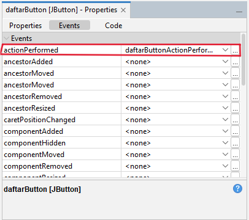
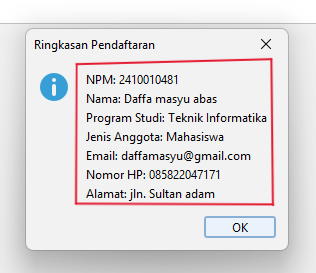
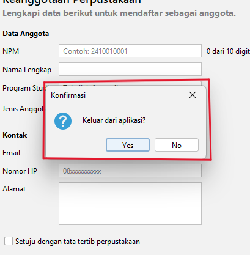

# P05 - Event Handling

| | |
|---|---|
| Nama | Daffa Masyu Abas |
| NPM | 2410010481 |
| Mata Kuliah | Pemrograman Berbasis Objek 2 (TIF1508) |
| Pertemuan | 5 - Event Handling |
| Proyek | `p05-event-handling` (package `id.ac.uniska.pbo2.p05`) |

## Daftar Isi

1. [Isi Proyek](#1-isi-proyek)
2. [Tabel Pengamatan Praktikum 2](#2-tabel-pengamatan-praktikum-2)
3. [Jawaban Eksperimen Praktikum 3](#3-jawaban-eksperimen-praktikum-3)
4. [Jawaban Eksperimen Praktikum 4](#4-jawaban-eksperimen-praktikum-4)
5. [Peta Event FormAnggotaPerpustakaan](#5-peta-event-formanggotaperpustakaan)
6. [Tangkapan Layar](#6-tangkapan-layar)
7. [Jawaban Pertanyaan Refleksi](#7-jawaban-pertanyaan-refleksi)
8. [Deklarasi Penggunaan AI](#8-deklarasi-penggunaan-ai)

---

## 1. Isi Proyek

| File | Keterangan |
|---|---|
| `PengamatEvent.java` / `.form` | Praktikum 2: mengamati event (Window, Mouse, Action, Item, Key, Focus) |
| `KonverterSuhu.java` | Praktikum 3: kelas logika konversi suhu tanpa GUI |
| `KonversiSuhu.java` / `.form` | Praktikum 3: form konversi suhu Celsius ke Fahrenheit, Kelvin, dan Reamur |
| `KalkulatorSederhana.java` / `.form` | Praktikum 4: kalkulator dengan tiga cara menghubungkan event |
| `FormAnggotaPerpustakaan.java` / `.form` | Latihan mandiri: form anggota perpustakaan yang sudah memiliki event |

---

## 2. Tabel Pengamatan Praktikum 2

| No | Tindakan | Event yang tercatat |
|----|----------|---------------------|
| 1 | Arahkan kursor ke tombol, lalu jauhkan | `MouseEvent`: kursor masuk ke tombol, lalu `MouseEvent`: kursor keluar dari tombol |
| 2 | Klik tombol Klik saya | `MouseEvent`: kursor masuk ke tombol (jika kursor baru diarahkan), lalu `ActionEvent`: tombol diklik |
| 3 | Centang lalu hapus centang Aktifkan fitur | `ItemEvent`: kotak dicentang, lalu `ItemEvent`: centang dihapus |
| 4 | Ganti pilihan dari Pagi menjadi Malam | `ItemEvent`: memilih Malam (satu baris saja karena event DESELECTED disaring) |
| 5 | Klik isian, lalu ketik kata "abc" | `FocusEvent`: isian mendapat fokus, lalu `KeyEvent`: mengetik huruf a, b, dan c |
| 6 | Klik tombol setelah mengetik di isian | `FocusEvent`: isian kehilangan fokus, `MouseEvent`: kursor masuk ke tombol, lalu `ActionEvent`: tombol diklik |

Catatan: saat jendela pertama kali dibuka, tercatat `WindowEvent`: jendela dibuka.

---

## 3. Jawaban Eksperimen Praktikum 3

**1. Berapa kali pesan tercetak setiap pilihan diganti (tanpa pemeriksaan `ItemEvent.SELECTED`)?**

Pesan tercetak **2 kali** setiap pilihan diganti. `itemStateChanged` pada Combo Box dipanggil sekali untuk pilihan lama (DESELECTED) dan sekali untuk pilihan baru (SELECTED).

**2. Mengapa hasil yang tampil terlambat satu karakter saat memakai `keyPressed`?**

`keyPressed` dipicu saat tombol baru ditekan, sebelum karakter dimasukkan ke dalam isian. Akibatnya `getText()` masih berisi teks sebelum ketikan terakhir. Sebaliknya, `keyReleased` dipicu saat tombol dilepas, ketika karakter sudah masuk ke isian, sehingga teks yang dibaca sudah lengkap.

**3. Apa yang muncul di jendela Output jika blok `try` dan `catch` dihapus lalu mengetik huruf?**

Muncul pesan error `NumberFormatException` (misalnya `For input string: "abc"`) beserta stack trace di jendela Output. Hal ini terjadi karena `Double.parseDouble` tidak dapat mengubah huruf menjadi angka, dan hasil di label tidak diperbarui.

---

## 4. Jawaban Eksperimen Praktikum 4

**1. Berapa kali pesan tercetak jika `kaliButton` memakai event handler GUI Builder dan lambda sekaligus? Mengapa satu tombol sebaiknya hanya memakai satu cara?**

Pesan "kali" tercetak **2 kali** setiap tombol diklik, karena ada dua listener yang terdaftar pada tombol yang sama. Satu tombol sebaiknya hanya memakai satu cara agar aksinya tidak berjalan ganda dan kodenya mudah dilacak.

**2. Apa saja yang diubah di tab Design dan tab Source untuk menambahkan tombol `%` (modulus)?**

- **Tab Design:** menambahkan satu tombol baru bertuliskan `%` ke dalam `operatorPanel`, lalu mengubah Grid Layout `operatorPanel` dari 4 kolom menjadi 5 kolom.
- **Tab Source:** membuat event `actionPerformed` untuk tombol `%` yang memanggil `hitung('%')`, menambahkan `case '%' -> a % b;` pada `switch`, dan menyesuaikan pemeriksaan pembagi nol menjadi `if ((operator == '/' || operator == '%') && b == 0)`.

**3. Mengapa kursor langsung berada di isian pertama setelah tombol Hapus ditekan?**

Karena method `hapus` memanggil `angka1Field.requestFocusInWindow()`, yang meminta fokus keyboard dipindahkan ke isian pertama sehingga pengguna dapat langsung mengetik lagi.

---

## 5. Peta Event FormAnggotaPerpustakaan

| Komponen | Menu Events | Aksi |
|----------|-------------|------|
| Kotak centang `setujuCheck` | Item: `itemStateChanged` | Tombol Daftar hanya aktif jika kotak dicentang |
| Tombol `batalButton` (Batal) | Action: `actionPerformed` | Mengosongkan semua isian dan mengembalikan fokus ke isian NPM |
| Tombol `daftarButton` (Daftar) | Action: `actionPerformed` | Menampilkan ringkasan data dengan `JOptionPane` |
| Isian `npmField` | Key: `keyReleased` | Label kecil `digitLabel` menampilkan jumlah digit, misalnya "8 dari 10 digit" |
| Form (`JFrame` di Navigator) | Window: `windowClosing` | Meminta konfirmasi sebelum aplikasi ditutup |

Pengaturan Properties tambahan:

- `defaultCloseOperation` form diubah menjadi `DO_NOTHING`, agar jendela tidak langsung tertutup sebelum pengguna menjawab dialog konfirmasi.
- Properti `enabled` pada tombol Daftar dihilangkan centangnya, agar tombol baru aktif setelah kotak setuju dicentang.

Seluruh event dibuat melalui klik kanan komponen, lalu Events di GUI Builder (atau lewat jendela Properties bagian Events), sehingga tersimpan di file `.form`. Aksi pengosongan isian ditulis dalam satu method `kosongkan()` agar logikanya tidak berulang.

---

## 6. Tangkapan Layar

### 6.1 Jendela Properties bagian Events untuk tombol Daftar

### 6.2 Dialog ringkasan

### 6.3 Dialog konfirmasi keluar

---

## 7. Jawaban Pertanyaan Refleksi

**1. Jelaskan peran sumber event, object event, dan listener dengan contoh dari kode Anda.**

Sumber event adalah komponen tempat kejadian terjadi. Pada `FormAnggotaPerpustakaan`, sumber event-nya adalah tombol `daftarButton` yang diklik pengguna. Object event adalah object yang berisi informasi tentang kejadian tersebut, yaitu `ActionEvent` yang diterima sebagai parameter `evt` pada `daftarButtonActionPerformed(java.awt.event.ActionEvent evt)`. Listener adalah object yang menjalankan tanggapan dan didaftarkan lewat `addXxxListener()`. Pada tombol ini, listener-nya adalah `ActionListener` yang didaftarkan NetBeans di `initComponents()`, dan method `actionPerformed()`-nya memanggil `daftarButtonActionPerformed(evt)`, yang menampilkan ringkasan data. Jadi tombol tidak menangani kejadiannya sendiri, tetapi menyerahkannya (mendelegasikan) kepada listener.

**2. Mengapa KeyListener tidak dapat ditulis dengan lambda, dan bagaimana NetBeans mengatasinya saat Anda memilih event keyReleased?**

Lambda hanya dapat dipakai untuk interface dengan satu method abstract (interface fungsional). `KeyListener` memiliki tiga method, yaitu `keyPressed`, `keyReleased`, dan `keyTyped`, sehingga bukan interface fungsional dan semua methodnya wajib ditulis. NetBeans mengatasinya dengan memakai kelas adapter `KeyAdapter`, yang menyediakan implementasi kosong untuk semua method. Karena itu, saat saya memilih event `keyReleased` pada `npmField`, hanya method `npmFieldKeyReleased` yang perlu saya tulis isinya.

**3. Apa keuntungan memisahkan KonverterSuhu dari form KonversiSuhu?**

Logika perhitungan menjadi terpisah dari kode tampilan. Keuntungannya: logika mudah dipakai ulang oleh form lain, mudah diuji tanpa harus menjalankan GUI (seperti yang akan dibahas di Pertemuan 13), dan kode form menjadi lebih ringkas karena hanya membaca isian, memanggil `KonverterSuhu`, lalu menampilkan hasil.

**4. Mengapa aksi pada itemStateChanged perlu memeriksa ItemEvent.SELECTED?**

Karena `itemStateChanged` pada Combo Box dipanggil dua kali setiap pilihan diganti: sekali untuk pilihan lama (DESELECTED) dan sekali untuk pilihan baru (SELECTED). Tanpa pemeriksaan `evt.getStateChange() == ItemEvent.SELECTED`, aksi di dalamnya berjalan dua kali. Dengan pemeriksaan itu, aksi hanya dijalankan sekali, yaitu saat ada pilihan baru yang dipilih.

**5. Kapan Anda memakai event handler dari GUI Builder, lambda, atau method reference?**

- **Event handler GUI Builder** dipakai sebagai cara utama pada JFrame Form, misalnya `daftarButtonActionPerformed` dan `npmFieldKeyReleased`. Event ini dibuat lewat Events, tersimpan di file `.form`, dan mendukung listener dengan banyak method lewat adapter.
- **Lambda** dipakai untuk aksi singkat yang ditulis di konstruktor setelah `initComponents()`, dan hanya untuk interface fungsional seperti `ActionListener` dan `ItemListener`. Contohnya `kaliButton.addActionListener(e -> hitung('x'));`.
- **Method reference** dipakai ketika aksinya sudah ditulis sebagai method tersendiri. Contohnya `hapusButton.addActionListener(this::hapus);`.

Satu tombol cukup memakai satu cara agar aksinya tidak berjalan dua kali.

---

## 8. Deklarasi Penggunaan AI

Saya menggunakan **Claude (Anthropic)** untuk membantu memahami isi modul, menganalisis soal latihan, memeriksa jawaban eksperimen dan pertanyaan refleksi, menyusun README, membantu memperbaiki error build Maven (versi Java pada `pom.xml`), serta membantu mengatur layout dan menyesuaikan kode `FormAnggotaPerpustakaan` dengan nama komponen di form saya. Seluruh kode saya jalankan, uji, dan tangkap layarnya sendiri di Apache NetBeans.
